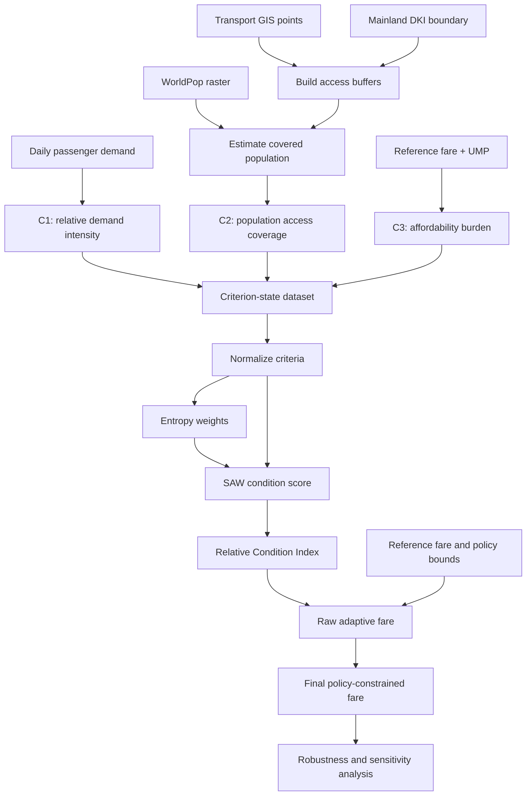

# Adaptive Fare Recommendation for Jakarta Public Transportation Using Entropy-Weighted SAW and Multimodal Mobility Indicators

> **Research prototype — not a real-time fare-setting system.** The current baseline uses daily passenger-demand observations from 2023, together with selected 2026 fare and economic benchmarks. The resulting fares are simulations/recommendations subject to policy constraints, not validated optimal fares or approved tariff changes.

## 1. Project Overview

This project develops a decision-support framework for adaptive fare recommendation across three public-transport modes in Jakarta:

- TransJakarta
- MRT Jakarta
- LRT Jakarta

The framework combines multimodal passenger demand, population access coverage, and fare-affordability burden. **Entropy Weighting** derives objective criterion weights from the decision matrix, and **Simple Additive Weighting (SAW)** calculates a composite condition score. A Relative Condition Index (RCI) compares each observation with its mode-specific baseline. The model then calculates a raw fare recommendation and applies policy-defined fare bounds to obtain the final policy-constrained fare.

The project's contribution is the integration of these indicators and policy constraints into an adaptive fare-recommendation workflow. It does **not** propose a new MCDM algorithm.

## 2. Current Research Scope

| Item | Current configuration |
|---|---|
| Geographic scope | Mainland DKI Jakarta; Kepulauan Seribu excluded from the spatial population analysis |
| Transport modes | TransJakarta, MRT Jakarta, LRT Jakarta |
| Demand observation period | 1 January–31 December 2023, with 243 observed dates |
| Number of mode-date observations | 729 (243 dates × 3 modes) |
| Primary accessibility radius | 500 metres |
| Accessibility sensitivity radii | 400 m, 500 m, 800 m |
| Economic benchmark | DKI Jakarta UMP 2026: Rp5,729,876 |
| Fare sensitivity parameter | `alpha = 0.10` for the main scenario |
| Weighting and scoring | Entropy Weighting + SAW |
| Fare interpretation | Historical-demand-based simulation using selected 2026 benchmarks; not real-time pricing |

**Naming note:** Several exported filenames end in `_2026`. In the current pipeline, this suffix identifies the 2026 benchmark/scenario run; it does not mean the demand observations are from 2026.

## 3. Data Inputs

The current notebook/script expects the following local inputs. File names must match the paths configured in the code, or the configuration must be updated accordingly.

| Input | Role | Current use |
|---|---|---|
| `Filedata Jumlah Penumpang Angkutan Umum yang Terlayani per Hari Tahun 2023.csv` | Daily ridership | C1 demand indicator |
| `Query Titik_Transportasi_Umum_Jakarta_v3 (ID 26).txt` | Transport GIS point records | TransJakarta and MRT facility points |
| `Query Titik_LRT_2026.txt` | LRT station coordinates | LRT facility points |
| `idn_pop_2023_CN_100m_R2025A_v1.tif` | WorldPop population raster (100 m) | Population covered by station/stop buffers and total mainland population |
| BIG DISIGT `BatasWilayah` service and local boundary cache | Administrative polygons | Mainland DKI Jakarta boundary |
| `Filedata Data Upah Minimum di Provinsi DKI Jakarta.csv` | UMP data | C3 affordability benchmark, with a current code fallback described under Data-quality notes |
| Reference-fare configuration in the code | Reference tariffs | Fare calculation and policy constraints |

### 3.1 GIS point validation

The current pipeline validates the expected number of mapped facility points:

| Mode | Point count |
|---|---:|
| TransJakarta | 378 |
| MRT | 22 |
| LRT | 11 |

These counts describe the records used by the current GIS pipeline. They should not be interpreted as a guarantee that every point is a distinct operational stop/station without separately checking source definitions and duplicates.

### 3.2 Spatial boundary and population

The cleaned mainland DKI Jakarta geometry passes the pipeline's area sanity check:

- Mainland area: **650.40 km²**
- WorldPop 2023 estimated mainland population sum: **10,886,086.23**

The population total is a raster-derived estimate, not a census headcount reported as an exact integer. The population data year and raster processing assumptions must be documented when reporting this value.

## 4. Criterion Construction

The model uses three criteria. In the current dataset, C1 changes by date and mode, while C2 and C3 are repeated for each observed date within a mode.

### C1 — Relative Demand Intensity (benefit)

**Raw variable:** `passenger_count`

Demand is normalized relative to the observed peak for the same transport mode:

\[
C1_{i}=\frac{PassengerCount_i}{PeakPassengerCount_{mode(i)}}
\]

This mode-specific normalization avoids comparing the absolute passenger-volume scale of one mode directly with another. The peak is estimated from the full observed dataset for the baseline model. The walk-forward experiment estimates the peak from training data only.

### C2 — Population Access Coverage (benefit)

**Raw inputs:** transport point coordinates, mainland boundary, and WorldPop population raster.

For each mode, mapped facility points are projected to a metric coordinate reference system, buffered, combined using a geometric union to prevent overlapping areas from being counted more than once, and clipped to mainland Jakarta. Population raster cells within the resulting access area are summed.

For the primary 500 m radius:

\[
C2_m=\frac{Population\ covered\ within\ 500\ m\ of\ mode\ m}{Total\ mainland\ population}
\]

The 400 m and 800 m scenarios are used for sensitivity analysis. C2 is a mode-level accessibility indicator in the current baseline, not a daily indicator.

#### Population access coverage results

| Mode | 400 m | 500 m (primary) | 800 m |
|---|---:|---:|---:|
| LRT | 1.0322% | 1.5676% | 3.4149% |
| MRT | 0.8046% | 1.2752% | 2.9710% |
| TransJakarta | 16.1788% | 22.7860% | 40.2202% |

These are estimates produced by the current facility points, boundary, and raster. They should be interpreted as population residing within the defined geometric coverage, not proof that every resident has convenient or usable access to the service.

### C3 — Fare Affordability Burden (cost)

**Raw inputs:** reference fare, UMP DKI Jakarta 2026, and an assumption of 60 trips per month.

\[
C3_m=\frac{ReferenceFare_m\times60}{UMP_{2026}}
\]

A lower burden is considered better. The assumption of 60 trips per month is a modelling choice and should be disclosed as such; it is not an observed individual travel pattern.

### Reference fares and policy bounds

| Mode | Reference fare | Policy minimum | Policy maximum |
|---|---:|---:|---:|
| TransJakarta | Rp3,500 | Rp3,500 | Rp3,500 |
| MRT | Rp14,000 | Rp3,000 | Rp14,000 |
| LRT | Rp5,000 | Rp5,000 | Rp5,000 |

These values are the current model configuration and must be verified against the applicable official tariff rules before publication or policy interpretation.

## 5. Processing Pipeline



### 5.1 Normalization

The full-sample baseline uses the following transformations:

- C1 (benefit): daily passenger count divided by the mode-specific observed peak demand.
- C2 (benefit): population access coverage divided by the maximum coverage in the dataset.
- C3 (cost): minimum affordability burden divided by the observation's affordability burden.

The resulting full-sample normalized values fall within `[0, 1]` in the current run.

### 5.2 Entropy Weighting

Let \(r_{ij}\) be the normalized value of observation \(i\) for criterion \(j\). The entropy calculation uses:

\[
p_{ij}=\frac{r_{ij}}{\sum_i r_{ij}}
\]

\[
e_j=-\frac{1}{\ln(n)}\sum_i p_{ij}\ln(p_{ij})
\]

\[
d_j=1-e_j,\qquad w_j=\frac{d_j}{\sum_j d_j}
\]

where \(e_j\) is entropy, \(d_j\) is diversification, and \(w_j\) is the final criterion weight. Zero proportions must be handled safely in implementations.

### 5.3 SAW Scoring

The SAW score is the weighted sum of the three normalized criteria:

\[
SAW_i=w_1C1_i+w_2C2_i+w_3C3_i
\]

### 5.4 Relative Condition Index (RCI)

The baseline condition for each mode is the mean SAW score across that mode's observations:

\[
RCI_i=\frac{SAW_i}{\overline{SAW}_{mode(i)}}
\]

Interpretation:

- `RCI = 1`: equal to the mode-specific baseline condition.
- `RCI < 1`: below the mode-specific baseline.
- `RCI > 1`: above the mode-specific baseline.

### 5.5 Raw fare recommendation and policy constraints

The main scenario uses `alpha = 0.10`:

\[
F_{raw}=F_{reference}\left[1+\alpha(RCI-1)\right]
\]

`alpha` controls the magnitude of adjustment; it is a scenario parameter, not an entropy-derived quantity.

The final fare is calculated by clipping the raw recommendation to policy bounds:

\[
F_{final}=clip(F_{raw},F_{min}^{policy},F_{max}^{policy})
\]

The raw and final fares must always be reported separately because policy clipping may remove some or all of the model-implied adjustment.

## 6. Baseline Results

### 6.1 Entropy weights

| Criterion | Entropy | Diversification | Weight |
|---|---:|---:|---:|
| C1 — Demand State | 0.993376 | 0.006624 | 0.051820 |
| C2 — Population Access Coverage | 0.897769 | 0.102231 | 0.799802 |
| C3 — Fare Affordability Burden | 0.981034 | 0.018966 | 0.148377 |

The weights sum to 1. C2 receives the largest weight in this decision matrix. This is a characteristic of the present dataset and normalization, not proof that accessibility should always receive this weight in every transport-fare setting.

### 6.2 Mode-level SAW summary

| Mode | Average SAW | Minimum SAW | Maximum SAW | Average daily rank |
|---|---:|---:|---:|---:|
| LRT | 0.195781 | 0.179594 | 0.210707 | 2 |
| MRT | 0.111835 | 0.090121 | 0.133676 | 3 |
| TransJakarta | 0.982806 | 0.949248 | 1.000000 | 1 |

The cross-mode score levels are strongly influenced by C2 and C3, which vary mainly by mode in the current setup. A mode's average SAW level should not be interpreted as a complete measure of operational quality or as an independent justification for a tariff increase.

### 6.3 RCI ranges

| Mode | Minimum RCI | Mean RCI | Maximum RCI |
|---|---:|---:|---:|
| LRT | 0.917320 | 1.000000 | 1.076237 |
| MRT | 0.805834 | 1.000000 | 1.195297 |
| TransJakarta | 0.965855 | 1.000000 | 1.017494 |

### 6.4 Raw and final fare results (`alpha = 0.10`)

| Mode | Minimum raw fare | Maximum raw fare | Minimum final fare | Maximum final fare |
|---|---:|---:|---:|---:|
| LRT | Rp4,958.66 | Rp5,038.12 | Rp5,000 | Rp5,000 |
| MRT | Rp13,728.17 | Rp14,273.42 | Rp13,728.17 | Rp14,000 |
| TransJakarta | Rp3,488.05 | Rp3,506.12 | Rp3,500 | Rp3,500 |

### 6.5 Policy constraint application

| Mode | Constrained observations | Constraint rate |
|---|---:|---:|
| LRT | 243 / 243 | 100.00% |
| MRT | 151 / 243 | 62.14% |
| TransJakarta | 243 / 243 | 100.00% |

**Critical interpretation:** LRT and TransJakarta have equal minimum and maximum policy fares, so their final fares cannot vary under this configuration. Their raw fares vary, but policy clipping fixes the final output at the reference fare. The apparent final-fare stability for these modes must not be presented as independent evidence of model stability.

## 7. Robustness and Sensitivity Analysis

The current pipeline includes the following experiments:

- Quarterly entropy-weight stability.
- Bootstrap entropy-weight stability.
- Criterion-weight perturbation of ±20%.
- Leave-one-criterion-out analysis.
- Alpha sensitivity (`0`, `0.05`, `0.10`, `0.15`, `0.20`).
- Demand perturbation at 5% and 10%.
- Demand-to-SAW-to-RCI-to-raw-fare monotonicity checks.
- Policy-clipping checks.
- Expanding-window temporal holdout / walk-forward analysis.
- Within-mode temporal robustness analysis.

### 7.1 Selected results

| Test | Current result |
|---|---:|
| Baseline entropy weight sum | 1.000000 |
| Weight sensitivity: minimum pooled SAW Spearman | 1.000000 |
| Criterion exclusion: minimum SAW Spearman | 0.942810 |
| Walk-forward: minimum pooled SAW Spearman | 1.000000 |
| Walk-forward: maximum mean raw-fare difference | 0.239301% |
| Walk-forward: maximum mean final-fare difference | 0.024882% |
| Within-mode: minimum RCI Spearman | 0.858372 |
| Within-mode: maximum mean raw-fare difference | 0.289559% |
| Within-mode: maximum mean final-fare difference | 0.035888% |
| Within-mode: minimum raw pricing-direction agreement | 80.41% |
| Monotonicity check | Passed in current run |
| Policy clipping implementation error | 0 in current run |

These are robustness metrics, not predictive accuracy metrics. No observed ground truth for an optimal fare is available, so the pipeline does not establish that a recommended tariff is economically optimal, socially optimal, or causally superior to the current tariff.

### 7.2 Interpretation cautions

1. The walk-forward SAW Spearman is computed over pooled holdout observations. Since cross-mode differences can dominate pooled ordering, a value of 1.0 does not by itself establish perfect within-mode temporal generalization. The separate within-mode results should be reported alongside it.
2. The final-fare differences are suppressed by fixed policy bounds for LRT and TransJakarta.
3. C2 and C3 are mode-level values repeated across dates. Current temporal adaptation is driven mainly by C1 demand. This should be addressed explicitly in the discussion.
4. The quarterly robustness output currently reports Q1, Q3, and Q4, while the printed walk-forward block ranges span dates in Q2. **The quarter assignment/date distribution must be audited and reconciled before these quarterly findings are treated as final paper results.**
5. The code that extracts UMP from the CSV currently falls back to `5,729,876` if parsing fails. Before final submission, replace this silent fallback with explicit source validation and document the authoritative UMP reference.

## 8. Generated Outputs

### Main datasets

- `criterion_state_dataset_2026.csv`
- `mcdm_normalized_dataset_2026.csv`
- `entropy_weight_results_2026.csv`
- `mcdm_saw_results_2026.csv`
- `dynamic_fare_results_2026.csv`

### Spatial/accessibility outputs

- `c2_population_access_sensitivity_2026.csv`
- `c2_population_access_coverage_500m_2026.csv`

### General robustness outputs

- `temporal_entropy_weight_stability_2026.csv`
- `temporal_saw_stability_2026.csv`
- `bootstrap_entropy_weights_2026.csv`
- `bootstrap_entropy_weight_summary_2026.csv`
- `weight_sensitivity_2026.csv`
- `criterion_exclusion_robustness_2026.csv`
- `alpha_robustness_2026.csv`
- `model_monotonicity_validation_2026.csv`
- `demand_perturbation_results_2026.csv`
- `demand_perturbation_summary_2026.csv`
- `model_robustness_dashboard_2026.csv`

### Temporal holdout outputs

- `temporal_holdout_summary_2026.csv`
- `temporal_holdout_detail_2026.csv`
- `temporal_holdout_aggregate_2026.csv`
- `temporal_holdout_rci_summary_2026.csv`
- `temporal_holdout_fare_summary_2026.csv`

The filenames above describe the current pipeline outputs. A within-mode temporal output was also produced in the latest execution; ensure that its export statement and filename are included in the code/repository before relying on it as a reproducible artifact.

## 9. Reproducing the Pipeline

The current workflow is notebook/script-based. Exact execution commands depend on how the code is organized in the repository.

### 9.1 Python requirements

The current code imports:

- Python standard library: `os`, `json`
- `pandas`
- `numpy`
- `requests`
- `geopandas`
- `rasterio`
- `shapely`
- `urllib3` (through the `requests` retry setup)

A starting dependency installation command is:

```bash
pip install pandas numpy requests geopandas rasterio shapely urllib3
```

For reproducibility, pin dependency versions in a `requirements.txt` after confirming the versions used in the final environment.

### 9.2 Execution sequence

1. Place all source files in the configured working directory or update the configured file paths.
2. Run data cleaning and validate the passenger counts and dates.
3. Load, deduplicate, and validate the transport GIS points.
4. Load or rebuild the mainland DKI boundary and validate its area.
5. Load the WorldPop raster and compute accessibility coverage for 400 m, 500 m, and 800 m.
6. Link primary 500 m C2 values to the mode-date dataset.
7. Calculate C1, C2, and C3 and validate the 729-row criterion-state dataset.
8. Normalize criteria and calculate Entropy weights.
9. Calculate SAW, mode-specific baselines, RCI, raw fares, and policy-constrained final fares.
10. Run robustness and temporal holdout experiments.
11. Review generated CSV files and check the data-quality notes in this README before writing final claims.

## 10. Limitations

- The current demand dataset is from 2023, not 2026 or real-time data.
- The 2026 fare and UMP values are benchmark inputs; the full run should document authoritative sources and applicable effective dates.
- C2 is based on geometric distance buffers and a gridded population raster. It does not model walking routes, barriers, transfers, service frequency, station capacity, or individual travel behaviour.
- The current C2 and C3 indicators do not vary daily within each mode.
- The assumption of 60 trips per month is illustrative and needs justification or sensitivity analysis.
- LRT and TransJakarta policy bounds are fixed at their reference fares, preventing final fare changes in the current model.
- No observed optimal-fare ground truth is available; robustness tests do not constitute fare-prediction accuracy evaluation.
- The current fare formula is a simulation framework. Its coefficients, affordability protections, and policy bounds require stakeholder/policy justification before operational use.

## 11. Recommended Next Steps

1. **Acquire and validate more current ridership data**, preferably daily observations for all three modes over a common period. Do not synthesize daily records from monthly totals.
2. **Audit dates and quarter labels** to reconcile the quarterly robustness output with the chronological holdout date ranges.
3. **Document and verify official tariff policy bounds**, their effective dates, and the source for the 2026 UMP benchmark.
4. **Review criterion design** so the model's temporal behavior matches the research objective; consider which operational indicators could validly change over time.
5. **Re-run all robustness checks** on the final, versioned dataset after any data or model changes.
6. If developing a user-facing application, distinguish the analytics prototype from a real-time system and require authorized policy approval before any actual tariff change.

## 12. Research Positioning

Suggested title for the current historical-demand baseline:

> **Historical-Demand-Based Adaptive Fare Recommendation for Jakarta Public Transportation Using Entropy-Weighted SAW and Multimodal Mobility Indicators**

If newer, adequately documented demand data replace the 2023 data, the shorter title may be reconsidered:

> **Adaptive Fare Recommendation for Jakarta Public Transportation Using Entropy-Weighted SAW and Multimodal Mobility Indicators**

The paper should state the demand year, benchmark years, modelling assumptions, and policy-constrained nature of the final recommendation explicitly regardless of the title.
